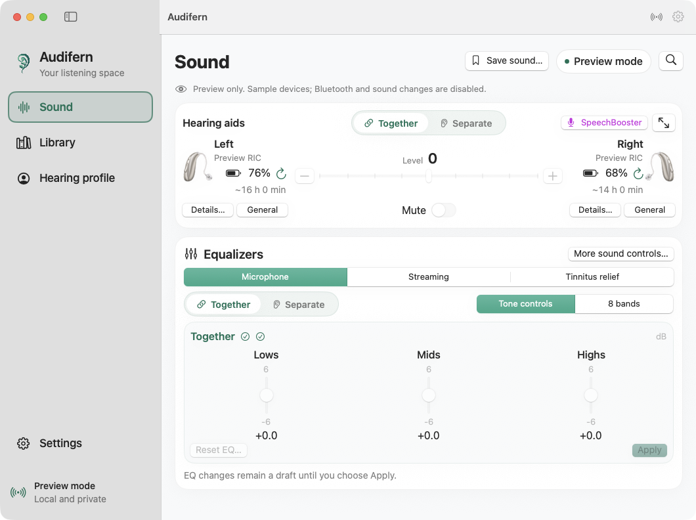

# Audifern

[](https://github.com/sabino/audifern/actions/workflows/ci.yml)
[](https://github.com/sabino/audifern/releases/latest)


**A quiet place to control your hearing aids on the Mac.**

Audifern is an independent native macOS app for compatible Oticon hearing aids.
Keep everyday listening controls close, then open sound adjustments, device
information or protocol diagnostics when you need them. Built with SwiftUI and
CoreBluetooth; no account, cloud service or analytics.

This is an early project tested with one Intent 3 pair. Volume and mute have
been physically confirmed; consumer EQ writes have matched aid readback.
Other models, fresh pairing and long-term reliability need further testing.
Audifern is not affiliated with or endorsed by Oticon or Demant.



[Dark mode in Português (Brasil)](docs/images/audifern-dark.png) ·
[Settings in Español](docs/images/audifern-settings-es.png) ·
[Eight-band EQ](docs/images/audifern-eq-eight-bands.png) ·
[Revised Sound controls in 0.8.2](docs/images/audifern-sound-clarity.png) ·
[Hearing profile](docs/images/hearing-profile-light.png) ·
[About and contributions](docs/images/audifern-about.png) ·
[Packaged app icon](docs/images/audifern-app-icon.png) ·
[Design concept, artwork and prompts](docs/design/prompts.md)

The original screenshots show the native 0.8.1 app; the revised Sound preview
shows the controls released in 0.8.2. All use synthetic devices, and preview
controls cannot change hearing aids. See [capture details](docs/images/README.md).

## Around the app

Audifern includes a configurable graphical menu-bar
panel, desktop widgets, macOS 26 Control Center controls and searchable native
Help. The top Together/Separate selector sets every sound section; individual sections
can override it and show **Mixed modes**, with an explanation on hover. EQ lives directly in Sound, with vertical
faders for both ears side by side or one shared set. Timestamped battery runtime
counts down locally between hourly device reads.
[Together](docs/images/audifern-sound-together.png) · [Separate](docs/images/audifern-sound-separate.png) ·
[Menu-bar panel](docs/images/audifern-menu-bar.png) · [Quick access settings](docs/images/audifern-quick-access.png) ·
[Device details](docs/images/audifern-device-details.png) · [Help](docs/images/audifern-help.png).
See [quick access, setup and platform limits](docs/quick-access.md) and
[the selected visual concepts](docs/design/quick-access-prompts.md).

Three main destinations keep related tasks together. Focused editors and advanced
settings open as native sheets attached to the app window, with Back and Done.

**About Audifern** is available from the app menu, menu-bar icon and Settings.
It credits [sabino](https://github.com/sabino), shows the localized
“Made with ❤️ and 🤖 in 🇧🇷” line, and offers optional Mercado Pago or
cryptocurrency contributions with local QR codes and copyable receiving
addresses. See [contributions and future supporter features](docs/contributions.md).

About and every Settings category fit without scrolling at the supported minimum
window size. Settings has full-row navigation and the same green selection as
the main sidebar. Longer categories use focused tabs and side-by-side cards.
**Settings → Connections** adds optional reconnection to chosen aids, wake/unlock
attempts, a tunable RSSI threshold, persistent pause/resume and explicit Mac
audio-output preferences. Automatic connection starts off. Control connections
and system audio are distinct; Android↔Mac audio handoff still needs physical
testing. See [connections and the handoff research](docs/connections.md).

| Destination | What you can do |
| --- | --- |
| **Sound** | Connect or disconnect, see both device images, batteries and active programs, and open each aid’s details. Adjust volume, mute and SpeechBooster, edit equalizers inline or save a sound. Identifiers are hidden by default. |
| **Library** | Switch between fitted programs and local presets. Apply a saved sound or inspect a program’s consumer metadata. |
| **Hearing profile** | Review saved fitting data, manage audiograms, prepare a fitting plan one step at a time, and open backups or comparisons. |
| **Settings** | Choose appearance and language, configure battery alerts, manage identifier visibility and open diagnostics. |

Equalizers offer microphone, streaming and fitted tinnitus controls, plus a
separate Source volume tab for supported streaming programs. Reset EQ is beside
Apply; Restore sound defaults sits underneath the editors. Choose Together for one shared editor or Separate for both ears side by side;
switch between three vertical tone faders and eight individually reported bands. Changes remain drafts
until Apply. Unknown frequencies retain numbered device-order labels.

Fitting planning uses five steps: About you, Hearing aids, Audiogram, Preferences
and Review. It saves a local plan and revision history. Saved fitting inspection
uses Overview, Programs, Buttons and alerts, and Advanced tabs. Clinical
programming and a complete fitting restore are not implemented.

The initial languages are **English, Português (Brasil) and Español**, with
system-language selection. Appearance follows macOS unless you choose an
override. Closing the window leaves connections and battery monitoring in the
menu bar; **Quit Audifern** ends them.

See the [fitting workspace preview and backup guide](docs/fitting-backups.md)
for the new local planning tools and the limits of saved fitting data.

The Sound page keeps device images beside the controls. Volume faders support
native macOS keyboard and accessibility input; dragging previews the level and
submits once on release. Linking preserves the existing left/right balance and
each ear’s mute state. Every target must fit the reported limits of both aids;
the app rechecks current volume and program and confirms each device write.
The scale marks device steps and labels the reported bounds and zero, including
asymmetric ranges such as -8 through +3. Levels are device steps, not percentages
or calibrated gain in dB.

## Download and install

[Download the latest release](https://github.com/sabino/audifern/releases/latest)
for **macOS 14 or later**, on Apple Silicon or Intel. Open the universal DMG and
drag Audifern to Applications; a ZIP is also available. Downloads include
checksums, build information, the license and exact source links.

Releases from **0.6.1** are **Developer ID signed and Apple-notarized**.
Continuous-build artifacts and the original 0.6.0 release remain ad hoc signed.
Read the [installation and release guide](docs/distribution.md) for verification,
continuous-build artifacts and the release process.
From 0.6.2, signed version tags also trigger signing and notarization in GitHub
Actions, using a protected environment available only to the trusted main workflow.
Advanced credentials are provisioned locally and are excluded from downloads.

## Build and try it

Requires **macOS 14 or later**, a **Swift 6** toolchain, Xcode with a macOS 26 SDK
or newer for the packaged widget extension, and Python 3 for audits/extractor tests. The Swift
package has no external package dependencies.

```sh
./scripts/build-app.sh
open "build/Audifern.app"
```

The build script signs locally with an ad hoc identity by default. You do not
need an Apple Developer account to build it. For repeated development builds,
set `AUDIFERN_SIGN_IDENTITY` to a stable local signing identity to help preserve
macOS Bluetooth permissions. `AUDIFERN_BUILD_JOBS` defaults to two.

To explore the interface without connecting hearing aids:

```sh
open -n "build/Audifern.app" --args --demo
```

Demo mode uses synthetic devices and isolated data. It does not open Bluetooth
connections or read the regular audiogram library.

For real devices, grant Bluetooth access when macOS asks. The tested aids were
already paired through **System Settings → Accessibility → Hearing Devices**.
Discovery can also recover an existing macOS connection when an aid is not
advertising. A complete first-time pairing flow is not established.

## Controls and their limits

| Capability | Current scope |
| --- | --- |
| Volume and mute | Direct BLE controls, per aid or linked, using reported limits and readback. |
| Program selection | Existing fitted programs only; more than one program has not been physically tested. |
| Consumer EQ | Tone controls or eight independent bands for microphone and streaming, with device-reported frequency labels when available. Advanced authentication is required for supported UTL controls. |
| SpeechBooster | Available only when the current program reports support and its controls can be loaded. |
| Tinnitus relief | Separate source volume/mute for an already fitted tinnitus program; unavailable when unsupported. |
| Streaming-source volume | Separate from EQ and Mac media volume; restricted to supported streamer programs. |
| Battery | Per-ear percentage, optional estimated time left and local milestone alerts. An estimate requires valid telemetry. |
| Consumer program export | Readable program metadata and current consumer adjustments, not a clinical fitting backup. |
| Audiograms | Local exam records and JSON/HIMSA XML export; no tones, diagnosis or prescription calculation. |

Opening Equalizers automatically reads the selected aid's current EQ with the
locally provisioned credential. Selecting **Both ears** loads a missing ear
without restarting the first read. Each ear shows loading, success or a retryable
error. Loading does not apply sound changes.

Edits to EQ are drafts until **Apply**. Linked actions check both aids and
confirm each write; a failure can leave an earlier write applied, and the app
reports that partial result. Restore actions reset consumer adjustments after
confirmation, preserving clinical fitting and tinnitus therapy settings.

A **local sound preset** recalls adjustments to an existing program. It does
not create a fitted program inside the hearing aids. The consumer protocol
research has not established an add/create/clone-program operation. See
[program data and fitting boundaries](docs/program-data.md).

Audio streaming remains with macOS. Clinical fitting writes, audiogram-to-gain
conversion and firmware updates are not implemented. A complete readout of
installed firmware has not been established. Tinnitus controls cannot enable
an unfitted therapy; use the program's fitted level and daily-use limits.

### Advanced authentication

Basic direct BLE volume/mute does not require a cloud login or a bundled secret.
Advanced UTL features require a compatible authentication key supplied locally
by the device owner. **The key, vendor APK and SDK are not included.**

If you already have the inspected private SDK reconstruction, the offline
provisioning helper can read its key without printing or embedding it:

```sh
python3 scripts/provision-utl-key.py /path/to/private/UtlChallengeAuthentication.cs
```

This helper is specific to the researched SDK format. It is not a download or
a general key-acquisition service. Without compatible local authentication,
advanced features remain unavailable. See [advanced controls](docs/advanced-controls.md).

## Privacy

Your presets, exams, preferences and authentication material stay on your Mac.
There is no automatic log upload. Explicit exports and developer probes can
contain sensitive information; review them before sharing. Public screenshots
must use demo data. See [the privacy guide](PRIVACY.md) and
[public-source audit](docs/public-release-audit.md).

## Development

```sh
swift test --jobs 2
python3 -m unittest discover -s Tests -p 'test_*.py'
python3 scripts/audit-localization.py --strict
python3 scripts/generate-brand-assets.py --check
python3 scripts/audit-public-source.py \
  --allow-identity "$(git show -s --format='%an <%ae>' HEAD)"
```

Review the contributor identity before allowing it. The privacy checker flags
embedded signatures for review; see [public-history verification](docs/public-release-audit.md#public-distribution)
for the owner's intentionally signed commits.

The app, widgets and Dock icon use exports of the canonical
[branding/mark.svg](branding/mark.svg). See [brand asset regeneration](docs/design/prompts.md#canonical-brand-mark)
when changing the artwork; normal builds use the checked-in exports.

The optional HIMSA schema check needs a locally acquired `Audiogram-1-502.xsd`:
set `HIMSA_AUDIOGRAM_SCHEMA` to its path when running Swift tests. The schema is
not distributed. CI tests synthetic protocol/data cases, audits translations,
tests both CPU architectures, packages downloadable universal DMG/ZIP artifacts
and verifies signatures; it cannot establish physical aid behavior. [Hardware verification](docs/hardware-verification.md) distinguishes
audible confirmation, device readback, synthetic tests and remaining gaps.

Contributions are welcome: start with [CONTRIBUTING.md](CONTRIBUTING.md), and
use [SECURITY.md](SECURITY.md) for a private security report.

## License and identity

The project's original implementation is licensed under **GNU GPL version 3
only** (`GPL-3.0-only`); see [LICENSE](LICENSE). This does not grant a license to
vendor SDKs, authentication material, firmware or other excluded research inputs.
[Third-party notices](THIRD_PARTY_NOTICES.md) describe those boundaries.

Audifern is a project-specific name and brand, separate from the vendor's
Companion app. No trademark clearance or vendor endorsement is implied.

## Research

The implementation grew from inspection of an installed Android application
and bounded checks on the owner's hearing aids. Protocol findings are tied to
artifact identities and retained evidence, with unsupported operations kept
separate from implemented controls.

- [Direct BLE controls](docs/legacy-protocol.md) and [UTL transport/authentication](docs/managed-protocol.md)
- [Consumer EQ and presets](docs/advanced-controls.md), [SpeechBooster](docs/speech-booster.md), [source controls](docs/tinnitus-controls.md)
- [Program data](docs/program-data.md), [audiograms](docs/audiogram.md), [Noah/fitting research](docs/noah-investigation.md)
- [Fitting backups and workspace](docs/fitting-backups.md), [Genie feature map](docs/genie-feature-map.md)
- [Battery telemetry](docs/battery-telemetry.md), [identification](docs/device-identification.md), [device metadata](docs/device-metadata.md)
- [Firmware investigation and unresolved readout](docs/device-research.md), [hardware evidence](docs/hardware-verification.md)
