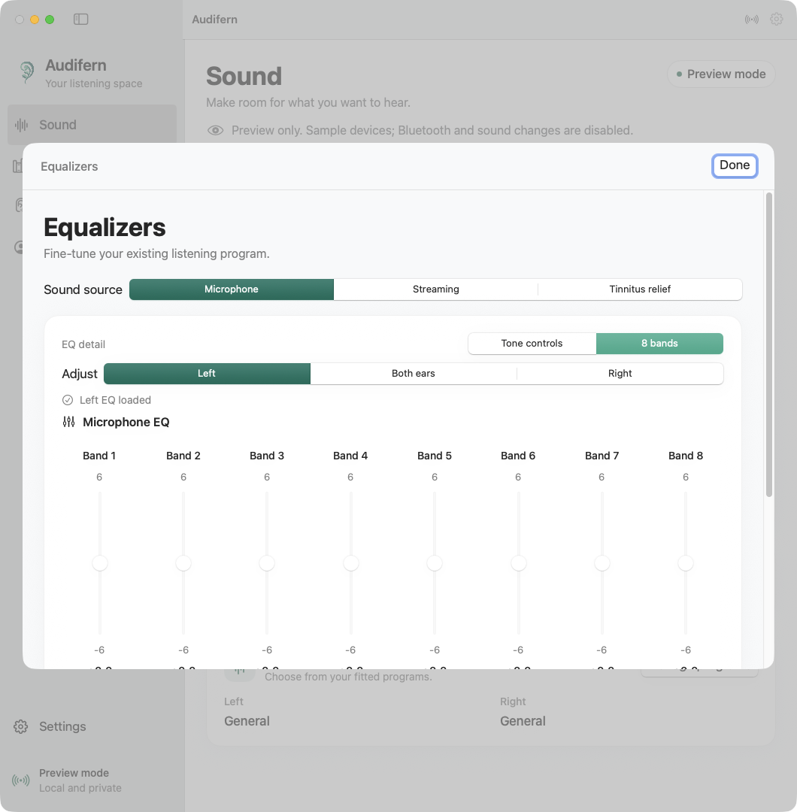

# Advanced consumer controls

This investigation uses the installed Oticon Companion 1.8.0 (617548) APK,
its recovered managed assemblies, and the earlier read-only GATT inventory.
Algorithms below are interpretations of static CIL/decompilation, not proof
that the hearing aids accepted an advanced control. No fitting gains, maximum
output levels, compression rules, receiver calibration, or audiogram-to-gain
formula are inferred from these consumer equalizers.

## Evidence ledger

| Finding | Shipped-artifact evidence | Interpretation and boundary |
| --- | --- | --- |
| Streaming EQ and program metadata GATT layout | `ev_2676fa403e3a405dfeff26112599d4a1850ffc0569911a5fa250a41abdf9c866` | `EqualizerCommandData`, `ProgramInfoCommandData`, `WdhHiServiceClient` in `Demant.MpHal.LegacyRemoteControlManager.dll`, SHA-256 `d5b0f7a2c3ed17bf8b4e801eedc1aaa290a19e59f02c837689dea8933bb53288`, MVID `727bc5cb-0147-49d5-ad68-384b85758e1d`. Static format and call relationships. |
| Three UI bands, signed coefficients and dB conversion | `ev_117fcb55eb1b6a71cf91bd3704d423ba45d0057257dd1eaea0689ed11467512f` | `EqualizerConverter` and microphone-EQ read command in `Demant.OneApp.Lib.Hal.Wrapper.dll`, SHA-256 `e13600d24d5f44d6f173be4d1df3822b294a7b2341c986ea03dbffe4b00dcfd8`, MVID `0ca344f6-16d9-4f18-9cc2-80c7ab5a6137`. Device-specific interpretation still requires runtime values. |
| UTL vector arguments are sequential CBOR values | `ev_c367620a03c78cb20008502fe42485d21e80331e76ade8d1ecf334195ff081ad` | `DecoderBase` / `EncoderBase` in `Demant.MpHal.MetaxRuntimeModel.dll`, SHA-256 `c38188c38606d15eda95fd2752f055825d4c5f12e2bdf41b6ab8e7624bb922f5`. `getDataVector` consumes one CBOR integer array and advances; the level/min/max vectors are separate adjacent arrays. `putDataVector` emits one CBOR integer array. |
| Ordinary commands are wrapped in COMMAND transactions | `ev_8b4fccd8cdceb60cb5a4d5b953b524991b188305fdaf50be038ac5d80686b39f` | `InitializedState.InsertTransactionCommandsIfNeeded` / `OperationCollection.GetOperationList` in the previously identified Ninjago assembly. The SDK inserts `start_transaction(type=COMMAND, id)` before consumer commands and `commit_transaction(id)` afterward. These are distinct from memory transactions. |
| Consumer sessions are nonexclusive Interactive sessions | `ev_7339ebb24e71c3e818bc466650bc803263cf03fca91999de62958f5575742195` and `ev_93135706e3bc2844b768fd07ddaceb522646c3a19aaa3ce2e0bae5e546b4ab08` | ChipService `OpenHiSessionAsync` / interactive transition and Wrapper consumer activation / session creation. ChipService SHA-256 `21cd01da616403f3f843dc4b35fd49957180c4f072728d23c6fe9d9018a1fae3`. Establishes the official consumer session envelope, not fitting-state entry. |
| Version-1 consumer EQ readers ignore wire ranges and use fixed limits | `ev_c711b878894b1f8977ae15eda14e5eea36b208e380ecc1908a2ba3ac38948bab` | Wrapper microphone UTL, streaming UTL/GATT readers and `EqualizerConverter`, bound to the Wrapper SHA/MVID above. V1 readers extract levels, use the historical scale and supply fixed UI bounds. V2 reads scale/range data. Nearest-even endpoint quantization is significant. |

REA summaries preserve full selected members in the ignored local exports
`private/rea-advanced-evidence.json`, `private/rea-consumer-session-evidence.json`
and `private/rea-equalizer-ranges-evidence.json`. Metadata tokens are build-local; CIL
analysis did not execute target assemblies. Existing UTL authentication and
framing evidence is indexed in [managed-protocol.md](managed-protocol.md).

## Lows, mids and highs

The official UI's three bands expand to eight wire coefficients:

- Low: coefficient 0.
- Mid: coefficients 1, 2, 3.
- High: coefficients 4, 5, 6, 7.

This grouping alone does not establish eight specific center frequencies.
Audifern now retains validated `freqs` from the same aid's consumer `get_info`
response. Both original SDK source readers query this shared service metadata.
The UI names channels only from that response; absent or invalid optional labels
leave numbered bands. An ordered eight-frequency axis is bounded to finite,
ascending audio frequencies. Saved EUS microphone labels corroborate this axis
for the researched pair, but are never substituted for live metadata or borrowed
as a streaming map. Coefficients are signed 8-bit
values transported either as raw two's-complement bytes or CBOR integers.
The historical step is `20 * log10(2) / 32`, approximately 0.18814 dB.
UTL `get_info` may report a `stepsize` that replaces that scale; Audifern
requires it for a version-2 EQ contract. Converted values use nearest-even
rounding. Every proposed band must fit every constituent coefficient's bounds.

The direct streaming characteristic is
`60415E72-C345-417A-BB2B-BBBA95B2C9A3`. Its 16-byte value contains eight
tinnitus-attenuation bytes followed by eight streaming-gain bytes. The app
reads a fresh value, preserves the complete tinnitus portion, writes the
streaming portion, and confirms the complete value by readback. An eight-byte
characteristic alone does not support this streaming format.

The official legacy GATT reader supplies consumer bounds of -12 to +6 dB.
These are app-defined bounds, not claimed as hardware-reported bounds.
The independent codec uses the same nearest-even quantization as the installed
app: +6 dB becomes coefficient 32 and -12 dB becomes -64. The decoded values
are approximately +6.0206 and -12.0412 dB; rejecting those boundary coefficients
would reject ordinary settings created by the official app. UTL version-2 reads
provide per-coefficient minimum and maximum vectors. The SDK's version-1.1/1.2
consumer readers instead use fixed limits of -6 to +6 dB for microphone and
-12 to +6 dB for streaming, ignoring the wire min/max arrays. Those arrays can
therefore be empty or scalar without invalidating the eight level coefficients.
The app marks these limits as SDK consumer limits, not hardware-reported bounds.
Existing irregular eight-band shapes are preserved until the user deliberately
applies the three-band editor.

## Program names

Available program IDs come from the already verified program bitmap.
Reading a name requires writing the metadata cursor
`68BFA64E-3209-4172-B117-F7EAFCE17414`, then reading
`BBA1C7F1-B445-4657-90C3-8DBD97361A0C`. The value contains category, UTF-8
byte length, name bytes, and tinnitus/boostable flags. The cursor is released
with `0xFF`, matching the installed client. This cursor is different from the
active-listening-program characteristic; reading a name does not select the
listening program. The GUI can query it automatically; ordinary probes omit it.

Names are displayed only when actually read. A label such as `Geral` is not
hardcoded from the user's description. Program changes invalidate cached
microphone EQ, streaming EQ and volume ranges until refreshed.

## Advanced UTL path

Opening the Equalizers editor automatically reads consumer EQ for the selected
ear using the locally provisioned credential. Selecting Both ears requests only
missing EQs; duplicate requests reuse an in-progress read. Changing targets does
not cancel the channel's owned transaction. Loading never sends EQ-set commands.
Errors are shown for each ear with an explicit Retry action; failed reads do not
loop automatically. Program or connection changes invalidate the read context.

EQ acquisition is separate from optional battery, identification and
SpeechBooster queries. It waits briefly for an existing device operation and
uses a shared deadline for EQ info and values. Neither ordinary connection nor
opening the editor enters fitting mode. The advanced channel implementation:

1. Reads GATT transport information and chooses a closed channel within the
   advertised channel count. It never takes over an open channel.
2. Subscribes to the control and selected output characteristics.
3. Opens that channel with the process client ID and authenticates using a
   separately provisioned local key. No key exists in tracked code or fixtures.
4. Verifies the server proof before sending the client proof, negotiates the
   transport MTU, and reads the dynamic service registry.
5. Opens the ordinary nonexclusive Interactive session and its command pipeline.
6. For supported equalizer contracts, reads scale information and the current,
   minimum and maximum microphone/streaming vectors, inside ordinary COMMAND
   transactions.

Equalizer service ID is `0x02000010`. Supported static contracts are versions
1.0 through 1.2 and 2.0. Version 1.0 has streaming EQ only; microphone EQ starts
at 1.1. Commands are 0 streaming read, 1 streaming write, 2 info, 3 microphone
read, 4 microphone write. Command numbers are sent to the discovered runtime
handle, never used as fixed GATT handles. Writes are initiated only by a user
control or explicit preset apply, then followed by a confirming read.
Version-1 consumer readers use the historical dB scale; `get_info` is diagnostic
for scale selection on that path; validated frequency labels can still be
retained. Version 2 uses the reported `stepsize` and min/max arrays.

## Detailed eight-band controls

In **Sound**, choose **8 bands** above either microphone or streaming EQ. Both
sources retain their independent vectors and drafts. Returning to **Tone controls**
does not send or discard edits: the tone controls group the same eight pending
coefficients. Moving one tone slider changes its group; moving one detailed
slider changes only that coefficient. A tone value displays its group's minimum,
matching the historical consumer interpretation.

This in-memory native render uses invented values and a synthetic frequency map;
the second aid deliberately omits labels to show the numbered-band fallback.
Preview mode sends no controls.

Linking mirrors new edits to the selected channel/group in each ear's own draft.
It does not copy the other ear's untouched bands or clamp them to a shared range.
Each aid quantizes with its own scale and bounds when Apply is pressed. Both
vectors are preflighted before any request; connection, program, ranges and
reported frequency layout are checked again before each write. Conflicting
reported layouts require separate-ear edits. A successful write still requires
the existing exact coefficient readback; a paired change is not atomic.

Frequency metadata is scoped to one owned session and cleared on closure.
Changed axes invalidate pending drafts. Optional frequency fields in consumer
exports/backups preserve older archive compatibility. These are consumer sound
adjustments, separate from the fitted Gain/MPO grids.

The 2026-10-21 read-only capture received all eight Hz labels for both sources
on both aids: 500, 750, 1000, 1500, 2000, 4000, 6000 and 8000. The saved fitting
records stayed byte-identical to the previous capture. The new eight-band UI
has synthetic write/readback tests and native light/dark/narrow renders. A user
listening check of the new individual-band controls has not been performed.

The first physical advanced read authenticated and discovered services but
returned `0xD9` because the prototype omitted the SDK's ordinary consumer
transaction envelope. Further shipped-artifact tracing established that this
status does not by itself imply professional fitting. The consumer path uses
session service `0x02000009`, version 1.0 or 1.1, with:

- Opcode 0: open session type 3 (Interactive), random private token, seconds
  since 2020, consumer application class 3 and this application's own version.
  Version 1.1 adds its documented trailing byte 1.
- Opcode 4: open the transaction pipeline.
- Opcode 7: begin transaction type 5 (COMMAND) with a big-endian UInt16 ID.
- The single requested consumer EQ operation.
- Opcode 8: complete that COMMAND transaction with the same ID; opcode 9
  cancels it on failure. Reads use this envelope as well as writes.
- Opcode 1: close this client's consumer session during cleanup, followed by
  closing its owned UTL channel.

The independent implementation does not enter Exclusive/ExclusiveWrite,
controlled state, shelf mode or programming mode, take an access semaphore,
request a reset, or use READ/WRITE_RAM/NVRAM transaction types. Completing a
type-5 consumer command is not a blanket memory/NVRAM commit. Control writes
remain explicit user actions. Diagnostic progress includes stage names and
service versions without tokens, challenges, proofs or other key material.
Failed starts/operations clean up only this client's own session/channel.
Session closure invalidates both EQ caches, and streaming fallback requires a
fresh validated legacy read. A failed or ambiguous EQ change invalidates the
affected cached value. If transaction cancellation itself fails, the session
is poisoned and cannot accept more consumer commands; cleanup retains the
transaction identity and closes only this client's session/channel.

EQ response diagnostics contain the command label, byte count, bounded CBOR
shape/numeric-vector summary and at most 256 bytes of EQ payload hex. They are
separate session diagnostic events, not the primary status text. Authentication
messages are never passed to this diagnostic path. Parse errors identify the
equalizer and contract version; a generic numeric Swift enum error is not shown.

The local key file is `~/Library/Application Support/Audifern/utl-auth.json`,
with POSIX permissions `0600` and JSON shape `{"key":"<32 hex digits>"}`.
It is read only after the user requests advanced controls. Credentials and
authentication messages are not written to the session log. Synthetic tests
use an unrelated fixture key. The codec's supported CBOR subset rejects
indefinite containers, tags, malformed UTF-8, duplicate map keys and excessive
nesting/collection sizes rather than accepting ambiguous wire data.

## Local presets and remaining boundaries

A local sound preset records existing program selection, volume/mute, and any
verified consumer EQ. Applying it runs each write and readback serially and
stops on failure. It requires the same active fitted program; switching fitted
programs must be explicit, followed by refreshed ranges. The app never reports
a whole preset as applied after only a subset succeeds.

This does not create a new fitted hearing-aid program. The vendor consumer
profile manager also exposes selection of existing profiles, but that alone
does not establish profile creation or a safe audiogram-to-fitting pipeline.
Its automatic binaural synchronization is deliberately not copied into the
read-only advanced query. Professional fitting and persistent parameter writes
remain a separate, unresolved protocol and clinical-calibration problem.

## Validation

Pure codec tests cover the three-to-eight mapping, signed scale, per-band
range intersection, tinnitus preservation, UTF-8 program names, CBOR range and
scale responses, malformed input, and version bounds. A synthetic UTL peer
tests mutual authentication, discovery, the exact Interactive/COMMAND
transaction wire order and read-only info/microphone EQ queries. It cancels a
failed command before the next read, rejects an invalid server proof before
client proof or any service request, and verifies that occupied channels are
never displaced. A blocked-write-acknowledgement test verifies that credit
replies cannot be overtaken by the next data fragment. Failed cancellation
poisons the session so an unknown open transaction cannot be reused. The full
local suite passes 63 Swift tests; six separate Python extractor tests pass.

Actual runtime checks subsequently read **Geral**, authenticated consumer UTL
sessions and read microphone/streaming EQ on both Intent 3 aids. A user-initiated
left microphone-EQ change also matched its exact eight-coefficient readback.
Audible perception, streaming-EQ writes and right-EQ writes remain unconfirmed.
See [hardware verification](hardware-verification.md) for retained private
evidence and the distinction between those results and synthetic tests.
