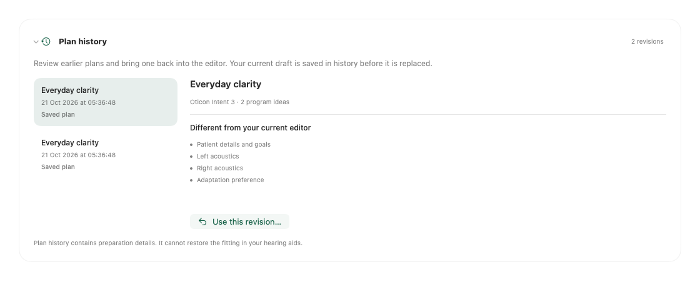
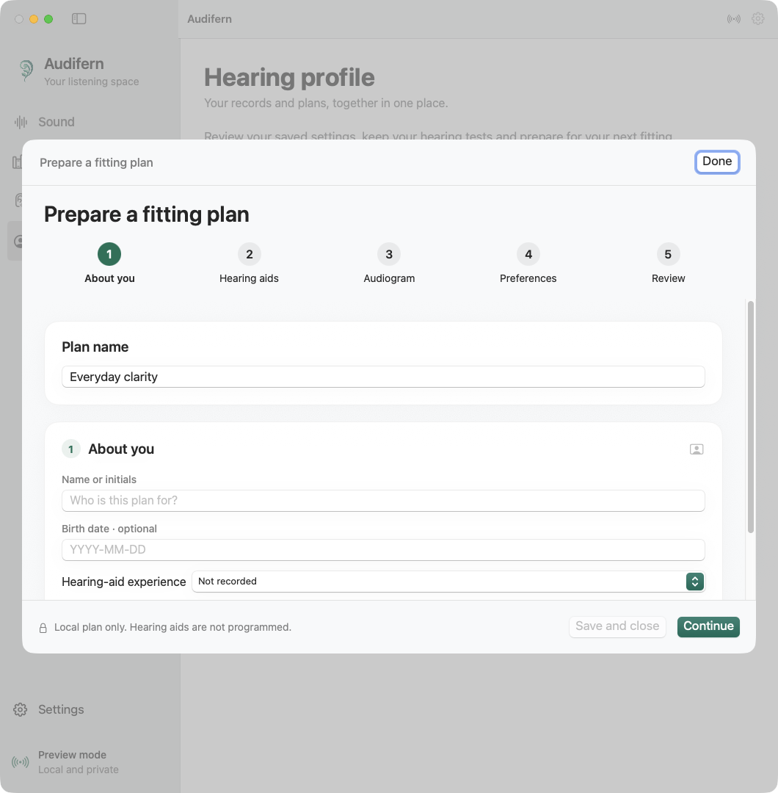

# Readable-state backups and fitted data

Audifern reads the saved fitting record and advertised persisted end-user-setting
scopes directly through CoreBluetooth on the tested Intent 3 pair. No Noahlink
was used for these reads. Complete fitting, restoration and other models remain
separate, unverified capabilities.

## Backups

**Backups → Back up readable state** reads fresh consumer controls and available
identification/program metadata. It saves and verifies that checkpoint from disk
before opening its owned nonexclusive ReadOnly session. Rejection never triggers
an exclusive or write session. Each completed fitting-record/EUS read is saved
in a new intermediate archive before continuing. A later timeout, disconnection
or state mismatch cannot discard those saved reads. Intermediate captures are
labeled as partial; a final capture additionally checks the current program and
volume against the original consumer checkpoint.

| Data | Coverage |
| --- | --- |
| Consumer checkpoint | Active program metadata, volume/mute and supported EQ/source/SpeechBooster getters that succeeded. The shareable consumer export keeps its narrower scope. |
| Identity and registry | Reported model, versions, local identifiers and observed services. New captures also retain the validated raw HIID response privately, including hardware selection fields. The tested pair returned 19 entries per aid; uninterpreted entries remain intact. Presence does not establish every operation. |
| Fitting record | HIID 4.5 entry 1009: header plus declared meaningful payload. The header is read twice and the device CRC checked. |
| End-user settings | EUS 2.1 inventory, optional metadata and successful persisted NVRAM getters. IDs/counts come from that inventory. Unknown, additional and RAM-only scopes remain outside coverage. |
| Excluded | Live RAM, complete calibration/device memory, installed firmware, original patient records and verified clinical restore. |

Files are append-only, UUID-named archives in
`~/Library/Application Support/Audifern/Backups/`. Directories use 0700 and files
0600 from creation. Unlike shareable diagnostics/consumer exports, **these private
files can contain identifiers and clinical data**. Nothing is uploaded or added
to the repository. Bounded versioned payloads and SHA-256 checks detect accidental
corruption, not malicious rewriting or missing clinical scopes. Invalid files
stay intact and visible as warnings; a new save never replaces an older backup.
No clinical restore or persistent fitting writer is implemented.

An explicitly selected CLI destination keeps its existing parent-directory
permissions. New dedicated directories are created with 0700; existing shared
directories are never silently changed. The private file itself is always 0600.

## Saved fitting and plans

**Fitting → Saved fitting** uses a verified archive without opening Bluetooth.
Ear/program selection changes only the inspector. The supported decoder shows
user programs separately from accessory/automatic records, labels, adaptation,
fitted processing, fitting software/rationale metadata and expandable gain/MPO
parameters. Additional saved views show acoustic categories, frequency lowering,
transient/wind choices, tinnitus setup, streaming/input preferences, tap actions
by listening context and hearing-aid notification preferences. Expandable hardware
identification stays separate from the saved acoustic selection. These views read
archived data, without sending controls or playing sounds. The decoder requires
Intent 3 release 5.0.29, HIID 4.5 and runtime map 10.0.0. Other records remain
preserved without an invented interpretation. When a raw identification response
is present, its reported profile and numeric model identifiers must agree before
this decoder is selected. Contradictory overlapping identity fields are rejected.

The [acoustics](saved-acoustics.md), [sound settings](saved-control-wire-evidence.md)
and [tap/notification preferences](saved-preferences.md) guides describe the exact
accepted formats and remaining unknowns. A stored setting does not prove current
activity, hardware availability or physical compatibility.

**Backups → Compare saved backups** compares two verified local captures per ear.
It checks aid identity before comparing fitting bytes, supported section bytes,
consumer controls and persisted end-user scopes. Missing observations have their
own result; two absent values never mean unchanged. A changed record can reflect
metadata rather than sound processing. This is a captured-data comparison, not a
restore plan or a sound-quality assessment.

Saved fitting audiograms are limited snapshots whose levels may have been
interpolated, rounded or clamped. The format omits measurement method, units and
original exam date, and can retain uncorrected ABR/nHL values. Local dB HL review
requires explicit external unit confirmation and copies only ordinary AC/BC
responses without conversion; raw levels and tags stay in the backup.

Gain values are stored parameter coordinates, not measured responses, hearing
thresholds, calibrated output or an established frequency/input-level graph.
Four rows cannot receive fixed input-level labels: the fitting also stores
per-channel knee-point vectors. The independently authored reader contains wire
facts, not vendor XML, databases, factory presets, fitting engines or curves.

**Fitting → Plan a fitting** stores a separate local draft: context, per-ear
acoustics descriptions, linked audiogram, model-gated rationale preferences,
adaptation preferences and program ideas. Saving calculates no gains, allocates
no device slots and sends no settings. Preparation steps track information,
not clinical approval. Unknown acoustics stay unknown; failed loads preserve
the old file and block silent replacement. The [feature map](genie-feature-map.md)
separates working controls, local planning, fitting-engine and measurement work.

**Plan history** keeps immutable, checksum-verified revisions on this Mac. Each
save preserves the preceding plan, including a plan created before history was
available. Repeated saves without edits do not create duplicates. The inline
browser shows which preparation sections differ from the editor; choosing a
revision preserves the current draft before loading it. Choose **Save plan** to
make that editor state the current saved plan. History cannot restore hearing-aid
settings, and a linked audiogram is a reference to the separate exam library,
not a copy of that exam. Unreadable revisions stay on disk and are reported.

The revision folder is `~/Library/Application Support/Audifern/FittingPlanRevisions/`.
New directories use mode 0700 and files use mode 0600. History is never pruned
automatically. An unreadable history directory blocks plan replacement; a plan
changed externally also needs an explicit reload before it can be saved again.
An interrupted save can leave a verified revision even when the current plan
file was not replaced. These files may include personal preparation notes.

[Plan history in dark mode](images/fitting-plan-history-dark.png).

[Dark appearance](images/fitting-plan-dark.png). These are in-memory native view
renders using synthetic content, without activating a window or connecting to
hearing aids. They show the local planning tool; they are not Genie screenshots
or evidence of a complete clinical fitting implementation.

## Protocol boundary

The read path uses session service `0x02000009` version 1.1, ReadOnly type 4 and
READ_NVRAM transaction type 2. HIID service `0x02000006` opcode 0 reads entry 1009
in chunks of at most 950 bytes. EUS service `0x02000017` version 2.1 has empty
inventory/metadata getters and opcode 2 for advertised scope/ID pairs. Failed
owned work is canceled and the owned session/channel closed. No controlled
state, memory write, update, reset or foreign-session takeover is used.

The augmented CRC uses polynomial 0x1021, initial 0xFFFF, MSB-first input and 16
trailing zero bits over the declared payload. Unread padding is not fabricated.
The known blob contains a raw fitting GUID and little-endian-length-prefixed
selection, production-register and business sections. Private bytes remain local.

## Verification, 2026-10-21

Both aids accepted read-only acquisition and returned CRC-valid 2,056-byte fitting
records with 2,040 meaningful payload bytes. All **25 advertised persisted EUS
scopes per ear** were captured. Active program and volume matched direct reads
before and after. Checkpoints and final archives were verified from disk and
original captures retained. No fitting was applied.

Both private production-register sections were independently decoded and
re-encoded byte for byte; the public Swift reader also decodes the actual saved
archive. An independent schema-driven check also matches all 118 newly exposed
sound-control coordinates across the pair. Saved tap/indicator preferences agree
with the captured metadata and global records; raw hardware fields and saved
acoustic categories agree for both aids. These checks establish format agreement,
not physical fitting or clinical equivalence. Synthetic tests cover bounds,
identity/version gates, CRC, fragments,
changed headers, rejection/cancellation, partial EUS capture, private permissions,
immutable saves, comparison coverage and corrupt-file preservation. Native view renders check light,
dark and narrow layouts without activating a window. Onscreen interaction and
clinical fitting equivalence remain separate verification work.

Private artifact-bound REA reports, original records and test logs are retained
under `private/genie/research-20261021/`. Public source contains no actual
thresholds, serials, authentication material or original vendor resources.
