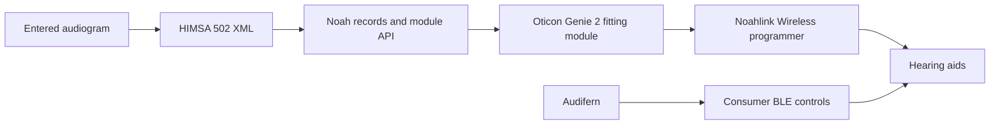

# Noah installer and audiogram investigation

Investigated on 2026-10-20 with the explicitly requested REA workflow. The
Windows installer and extracted programs were never executed. No hearing-aid
fitting, memory writes, firmware changes or Windows installation occurred.

## What the supplied installer actually contains

`~/Downloads/Noah_System_4.117.2.7400.exe` is 230,452,664 bytes, SHA-256
`350672a67f0e86e5d859259949f610c11cabb73c3eb02abd8b0bbb1ab62913b4`.
Its first 543,232 bytes are a native x86-64 WinRAR self-extracting launcher.
A RAR5 archive starts at file offset `0x84a00`. Reading that archive with
macOS `bsdtar` recovered the Noah bootstrapper, main InstallShield installer,
Basic Modules installer, .NET Framework 4.8 prerequisite, documentation and
administration tools.

The main installer contains an `ISSetupStream` version 3 container with 44
files. Its file-name-based obfuscation and zlib compression were decoded as
archive data. The recovered `Noah 4.msi` has SHA-256
`d61a5b2e18f4ce75620ac6cbd09bd0bf0b96cb50d8ea3a09543072fbcdae4aaf`.
Its Microsoft cabinet yielded 454 files, including Noah client/server,
database, ModuleAPI, BusinessAPI, IMC and audiogram-conversion components.

The Basic Modules package separately contains the Audiogram, Journal and
Questionnaire installers. Extracting its Audiogram installer recovered
`AudiogramModule.msi`, SHA-256
`86fcd7c9b93fef293cd7fa4b599c08a77bd11717bbe4aebdeecd028989aa806f`,
and 33 payload files including a WPF/.NET Audiogram Module, chart resources
and help files. The packaged help describes manually recording an existing
exam's results, selecting air/bone conduction and masking/no-response symbols,
then saving an audiogram action with its evaluation date.

The 454-file main cabinet has no filenames containing `Oticon`, `Genie`,
`Noahlink` or `HiPro`. This is a bounded filename inventory, not a proof that
no indirect support for a device exists. No Oticon-specific fitting algorithm,
Intent program-layout definition or manufacturer programmer was established
from this installer.

All proprietary material, extraction manifests, hashes, reconstructed code
and raw evidence are under ignored `private/noah/`. 7-Zip 26.03 was obtained
from its official site solely as a local archive reader; the downloaded Mac
archive hash matched the publisher's GitHub release hash
`5ca87677072c59f5602e5c49baa27d4694bacd2259b4e507f0094249d4281480`.
The source installer is unchanged.

## Records and fitting are separate paths

The Noah host stores and exchanges patient/session/action data. Its shipped
`ModuleAPI.dll` is an AnyCPU CIL assembly targeting .NET Framework 4.6,
SHA-256 `02801a7ec93395ab35e30488285b7fa3f020b2b3a7c71eb864691af12c89dc02`,
MVID `e613bc2a-9414-44f4-98fd-fea31bf856f4`. Its public metadata exposes
`CurrentPatient`, `CurrentSession`, module launch/registration and action
collections. An Action has `GetPublicData`/`SetPublicData`,
`GetPrivateData`/`SetPrivateData`, `CreateDate`, and `ReferencedActions`.
These are database/module interfaces; their existence does not provide a
manufacturer's hearing-aid programming protocol.

`IMC2DataDefinitions.dll` includes measurement conditions, target curves,
target points and signal/ear enumerations for inter-module communication.
Those data structures do not establish a prescription algorithm or a mapping
from a desired target curve to Intent DSP parameters.

HIMSA's [architecture description](https://himsanoah.atlassian.net/wiki/spaces/AD/pages/558367051/Noah+Architecture)
corroborates the Windows client/server and third-party-module arrangement.
Its [Hearing Instrument Fitting standard](https://himsanoah.atlassian.net/wiki/spaces/AD/pages/1309868356/Hearing+Instrument+Fitting)
only preserves an older reference to the audiogram used; it is not a standard
set of hearing-aid gain/programming parameters. Modern modules reference the
specific audiogram action.

Oticon identifies [Genie 2 and Noahlink Wireless](https://www.oticon.co.uk/professionals/clinical-experience/genie-2)
as the fitting software/programmer route for its Sirius platform and newer
wireless aids. That USB programmer route is distinct from the Mac's ordinary
CoreBluetooth connection and the consumer application's UTL/legacy remote
controls. Finding a UTL service in Companion does not establish that CoreBluetooth
can replace a Noahlink programmer for fitting.

## Audiogram interchange that we can implement now

The official [HIMSA Audiogram Format](https://himsanoah.atlassian.net/wiki/spaces/AD/pages/1312653313/Audiogram+Format)
page publishes an XML schema for version 502. Its downloaded revision 6 schema
has SHA-256 `39ea4a363fbfce4837ef51c08083377e10b6bc662124eb8bb3daaefe89442eb2`.
The schema and its samples are private reference inputs, not copied into the
application's distributed resources.

A minimal independently authored unmasked sample passed `xmllint --schema`
against that schema. Its root is `HIMSAAudiometricStandard`, `Version="502"`,
namespace `http://www.himsa.com/Measurement/Audiogram/502`. Each curve has
`AudMeasurementConditions` followed by `TonePoints`. Mandatory conditions are
stimulus/masking signal type, output and dB weighting. Optional transducer,
calibration, presentation and instrument data can be omitted when unknown.

For an unmasked pure-tone curve, outputs distinguish `AirConductorRight`,
`AirConductorLeft`, `BoneConductorRight` and `BoneConductorLeft`. An insert
phone should only be recorded when known. Each point records frequency in Hz,
presented level in dB HL and status such as `Normal` or `NoResponse`.
No-response is a measurement status, not a measured threshold. The schema
allows at most 18 threshold curves and 24 points per curve.

Masked measurements require their actual masking information. HIMSA's schema
documentation requires both masking frequency and masking level when masking
was applied, although the XSD cannot enforce that pair. A local record with
only a masked flag should retain it in JSON and refuse a lossy/fictional
HIMSA export. Never invent a masking level, calibration record, measured
transducer or `ValidatedByNOAH` approval attribute.

Standalone 502 XML is audiogram data, not a Noah patient database or `.nhax`
backup. Automatic import by the installed Noah GUI/Genie 2 has not been tested.
The [NHAX format](https://himsanoah.atlassian.net/wiki/spaces/AD/pages/3843752044/XML+Sections+in+NHAX+Files)
also has binary sections and patient/session/action metadata; changing a file
extension does not create one.

## REA evidence ledger

| Finding | Evidence | Coverage |
| --- | --- | --- |
| Original PE identity/resource tree | `ev_daf2e9058e77dbb916e65d9f0eb803e1e0e196793c26adb3a7ee727550fb442f` | Complete bounded resource tree; embedded archive decoded separately |
| ModuleAPI identity/framework | `ev_9de56beaa1bef402a7dd7d3c6700592bbbab25e5e673f2a8121b2dfee8e32596` | Static PE/CLI identity; no execution |
| Action/ModuleAPI/Session interfaces | `ev_ba530b9de729cf400884701abc30b0eba52874b18a1872eff8806fa6e59724aa` | Selected exact types; metadata and CIL anchors, not runtime behavior |
| IMC target/measurement structures | `ev_9603bb4bcb72a651a3e3ee558904eec53779c881947f8fd9f2cb4c70368596aa` | Selected exact types; does not infer algorithms |
| Native format-200 to format-500 converter | `ev_ad1ee853807d428ed8eb0c7da986b137d8ec6e9da111e08e73683ab1738e8b8f` | Ghidra function `0x1000cda0`; emits XML from legacy curves |
| Converter XML vocabulary | `ev_5c5f7a912980ebe5d6280abfdea44d5a135d1f0575b9e38714cd088fd94d22d8` | Ghidra constructor at `0x100011e0`; explicit 500 namespace and fields |
| Audiogram Module identity | `ev_76d740251eec29d3a9415215aaec54040a38999f020b545b438bcfb631c72099` | x86/.NET Framework 4.6; malformed/obfuscated metadata reported partial |
| Audiogram Module data operations | `ev_7999a0bd3828d5955e6cb2e1f97529f11f89d369aacb4a63b3ab8e3378124ebe` | `CloneAudiogramAction`, `CreateNewEmptyAudiogramAction`, `PutNoahAction` declarations; protected bodies remain unknown |

Native converter SHA-256 is
`ea5b552e017131700e0906f2701d0acea706be310b5a7c303b836aea42d7036c`.
Addresses are specific to that image. Managed tokens are meaningful only with
their image hash and MVID; the Audiogram Module's MVID could not be established
by the parser. Several decompiled public methods are protected stubs, so they
were not misrepresented as a recovered working implementation.

Saved evidence: `private/noah/returned-evidence-receipts.json`,
`private/noah/rea-managed-evidence.json`, `private/noah/rea-evidence.json`, and
`private/noah/converter-analysis.json`. The native REA target was closed after
exporting its evidence and analysis snapshot.

## Remaining work and limits

- Entering, saving, plotting and exporting an existing audiogram can be done
  locally on the Mac. This does not measure hearing or change hearing aids.
- A named local sound preset can recall verified consumer program/EQ/volume
  preferences. It does not create a new clinician-fitted firmware program.
- Creating/updating a fitted program from an audiogram still needs the
  manufacturer fitting component, Intent-specific parameter layouts,
  prescription/receiver/acoustic information, programming/session transport,
  and a verified backup/readback process. None of that has been established
  by this Noah installer analysis.
- A future Windows bridge could exchange standardized records with Noah or
  Genie 2 through supported interfaces. No Windows runtime, module integration,
  licensed SDK, manufacturer fitting session or device programming was tested.

## Official Genie 2 acquisition check

Checked public official routes on 2026-10-20 after authorization to find and
download the fitting software. No installer was acquired. [Oticon US support](https://www.oticon.com/support/help)
directs current Genie 2 downloads to MyOticon and identifies the programming
software as available to hearing-care professionals. An unauthenticated request
to [MyOticon](https://www.myoticon.com/) returned HTTP 307 to
`/auth/login?callbackUrl=%2F`. The [German product page](https://www.oticon.de/professionals/clinical-experience/genie-2)
also includes the MyOticon-account requirement and its fitting-software
section in its public page data. No account registration, login, alternate
credential use or access-control bypass was attempted.

The [Singapore product page](https://www.oticon.com.sg/professionals/clinical-experience/genie-2)
currently links instructions for use, including **2026.2**; these links are
manuals rather than installers. The official 2026.2 manual was downloaded to
ignored `private/genie/Genie2_2026.2_IFU.pdf`: 612,958 bytes, SHA-256
`ebb3dfb2dadb2d872d49e6eac703529e68d44035cfdb01e115bf345785e2d981`.
Its [installation and programming-device sections](https://damcdn.demant.com/2d421c18-c813-4944-80b3-b41200c9d498/298014UK_IFU_OT_Genie_2_26.2_Original%20file.pdf)
direct initial acquisition to the local Oticon representative and require
Noahlink Wireless/2 for Bluetooth-enabled aids from More onward. Noah is an
optional integration; Genie 2 also has its own client/audiogram database and
simulation mode.

Oticon's [Intent launch material](https://www.oticon.co.za/about-us/press/2024/2024-1)
explicitly describes fitting Intent with Genie 2. This establishes the intended
software family, not compatibility of an unacquired installer with this
particular Intent 3 firmware. That exact build/device check remains open.
Public page snapshots, redirect evidence and the manual's provenance are
retained under ignored `private/genie/`. A user-provided official installer or
an authorized MyOticon download is the next artifact for static analysis.
